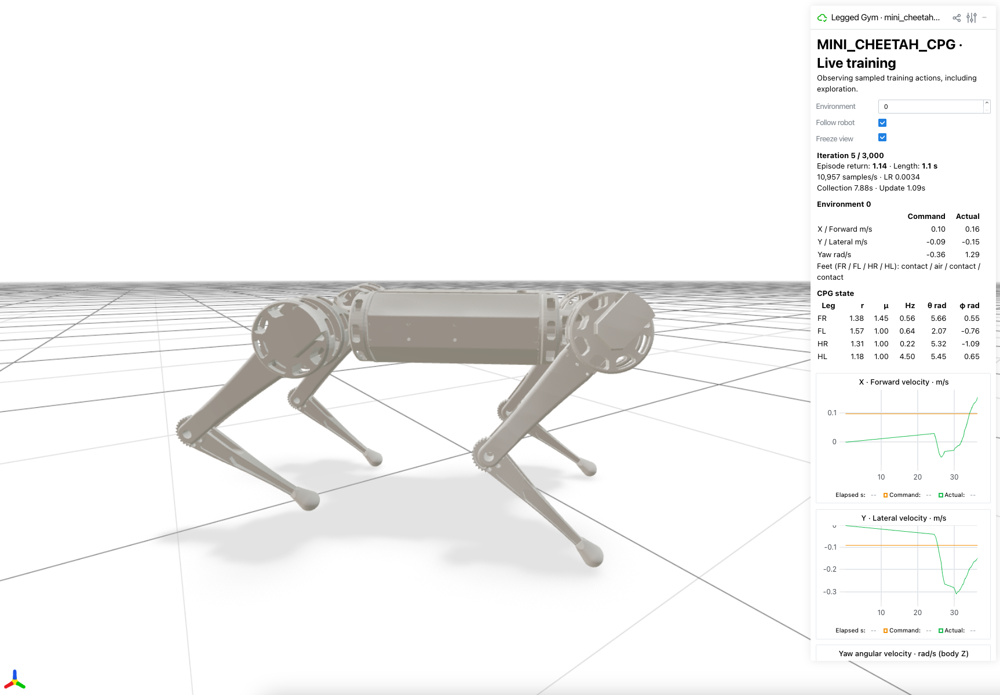

# CPG-RL & AllGaits · MuJoCo

[English](README.md) | **한국어**



**CPG-RL**과 **AllGaits**를 Mini Cheetah 사족보행 로봇에 적용한 MuJoCo/PPO 구현입니다. 물리 시뮬레이션은 CPU에서 실행하며, PPO 학습은 CPU·CUDA·MPS를 지원합니다. Python 3.10–3.13이 필요합니다.

| 논문 | Task | 구현 내용 |
|---|---|---|
| [CPG-RL (2022)](https://arxiv.org/abs/2211.00458) | `mini_cheetah_cpg` (기본값) | 다리별 진폭·주파수·방향 변화율의 12차원 행동. 기본 설정은 비결합 발진기입니다. |
| [AllGaits (2024)](https://arxiv.org/abs/2411.04787) | `mini_cheetah_allgaits` | 다리별 진폭·주파수의 8차원 행동. 9개 보행의 결합 행렬을 사용하며, 학습 중 3초마다 보행을 다시 선택합니다. |

두 방식 모두 **PPO → CPG → 발 궤적 → IK → 관절 PD 제어** 구조를 사용합니다. 비공식 구현으로, 로봇 기하·제어 게인·학습 범위·위상 인코딩은 원 논문과 다릅니다. 논문에 보고된 성능과 실물 로봇 실험까지 재현한 것은 아닙니다.

```bash
python3.12 -m venv .venv
source .venv/bin/activate
pip install -e .

# CPG-RL 학습 + Viser (http://127.0.0.1:8080)
cpg-train --num_envs 64

# AllGaits 학습 + Viser
cpg-train --task mini_cheetah_allgaits --num_envs 64

# 최근 학습 재개 — 학습할 때 사용한 task 지정
cpg-train --task mini_cheetah_allgaits --resume

# 재생 — model.pt를 실제 체크포인트 경로로 변경
cpg-play --checkpoint_path model.pt --headless
cpg-play --task mini_cheetah_allgaits --checkpoint_path model.pt --gait trot --headless

# 학습 지표
tensorboard --logdir logs
```

Viser에서 로봇·보상·CPG 상태·AllGaits 결합 행렬을 확인할 수 있습니다. 주황 화살표는 명령 속도, 초록 화살표는 실제 속도입니다. 명령은 로봇 몸체 좌표계 기준이며, `Front (+X)`가 앞쪽을 표시합니다. `--headless`로 Viser를 끄거나 `--viewer_port 8081`로 포트를 변경할 수 있습니다.

네이티브 뷰어로 재생하려면 `--headless`를 생략합니다. macOS에서는 `cpg-play` 대신 `mjpython -m legged_gym.scripts.play`를 사용합니다. AllGaits 재생은 `--gait`로 보행을 고정하거나, `--gait random`으로 3초마다 보행을 다시 선택할 수 있습니다.

체크포인트는 `logs/`에 저장됩니다. 재개·재생에는 학습과 동일한 `--task` 및 체크포인트와 같은 폴더의 `run_config.json`이 필요합니다. 설정: [config.py](legged_gym/envs/mini_cheetah/config.py). 추가 옵션: `cpg-train --help`, `cpg-play --help`.

라이선스: [LICENSE](LICENSE), [licenses/](licenses/). 로봇 자산 출처·관성 보정·재배포 관련 사항: [provenance.json](resources/robots/provenance.json).
