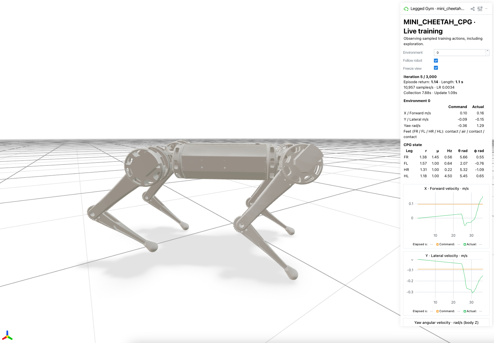

# CPG-RL & AllGaits · MuJoCo

**English** | [한국어](README.ko.md)



MuJoCo/PPO implementations of **CPG-RL** and **AllGaits**, adapted for the Mini Cheetah quadruped. Physics runs on CPU; the PPO learner supports CPU, CUDA and MPS. Requires Python 3.10–3.13.

| Paper | Task | Implementation |
|---|---|---|
| [CPG-RL (2022)](https://arxiv.org/abs/2211.00458) | `mini_cheetah_cpg` (default) | 12 actions: per-leg amplitude, frequency and direction rate; uncoupled oscillators by default. |
| [AllGaits (2024)](https://arxiv.org/abs/2411.04787) | `mini_cheetah_allgaits` | 8 actions: per-leg amplitude and frequency; gait coupling matrices for nine gaits, resampled every 3 seconds during training. |

Both use **PPO → CPG → foot trajectories → IK → joint PD control**. These are unofficial adaptations: robot geometry, control gains, training ranges and phase encoding differ from the papers. The papers' reported performance and hardware experiments have not been reproduced here.

```bash
python3.12 -m venv .venv
source .venv/bin/activate
pip install -e .

# CPG-RL training + Viser (http://127.0.0.1:8080)
cpg-train --num_envs 64

# AllGaits training + Viser
cpg-train --task mini_cheetah_allgaits --num_envs 64

# Resume the latest run; select the same task used for training
cpg-train --task mini_cheetah_allgaits --resume

# Playback: replace model.pt with a checkpoint path
cpg-play --checkpoint_path model.pt --headless
cpg-play --task mini_cheetah_allgaits --checkpoint_path model.pt --gait trot --headless

# Training metrics
tensorboard --logdir logs
```

Viser shows the robot, rewards, CPG states and AllGaits coupling matrices. Orange arrows indicate commanded velocity; green arrows indicate actual velocity. Commands use the robot's body frame, with `Front (+X)` marking forward. Use `--headless` to disable Viser or `--viewer_port 8081` to change its port.

For native playback, omit `--headless`. On macOS, replace `cpg-play` with `mjpython -m legged_gym.scripts.play`. AllGaits playback accepts a fixed `--gait` or `--gait random` for transitions every 3 seconds.

Checkpoints are saved under `logs/`. Resume and playback require the matching `--task` and the checkpoint's adjacent `run_config.json`. Configuration: [config.py](legged_gym/envs/mini_cheetah/config.py). More options: `cpg-train --help` and `cpg-play --help`.

Licenses: [LICENSE](LICENSE), [licenses/](licenses/). Robot asset sources, inertia corrections and redistribution notes: [provenance.json](resources/robots/provenance.json).
